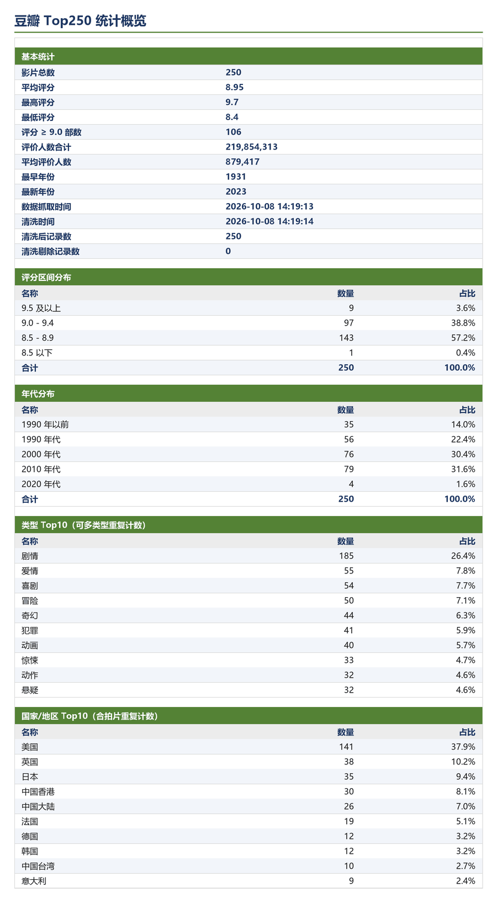

# 豆瓣 Top250 数据采集与清洗流水线

[](https://github.com/Zzzui01/douban-top250/actions/workflows/tests.yml)
[](LICENSE)

抓取 <https://movie.douban.com/top250> 的 250 条电影数据，落成 CSV / JSON，用 Pandas 清洗出派生列，
最后生成带样式与统计概览的 Excel 报表。全流程 CLI 驱动，支持断点续传与离线重跑。

## 项目简介

独立设计并实现的一条小型数据流水线：采集 → 解析 → 清洗 → 报表

**我的工作**：定义 13 个数据字段与 Excel 统计口径；设计断点续传语义与每页检查点机制；
通过真机抓取记录豆瓣风控的时间线，据此确定请求节奏与止损策略；设计清洗规则与 128 项离线测试；
定位并修复“被风控中断时已抓数据被整体丢弃”的缺陷。

**技术栈**：Requests / BeautifulSoup / Pandas / openpyxl / pytest / argparse / logging

> 开发过程中使用 AI 辅助生成初版代码与调试，但架构设计、反爬策略取舍、
> 清洗规则与测试用例由本人主导。

## 快速开始

完整参数表与常用组合见 [docs/usage.md](docs/usage.md)
环境要求：Python 3.8 及以上（开发与验证环境为 Python 3.8.8），无系统级依赖。

```bash
git clone https://github.com/Zzzui01/douban-top250.git
cd douban-top250
pip install -r requirements.txt

python bot.py                                   # 全量：10 页 250 条 → 清洗 → Excel
python bot.py --resume --only-pages 1,2,5,8     # 小批量补刷（被限流时推荐）
python bot.py --resume --refresh --pages 2      # 日常只刷新榜单前 2 页
python bot.py --from-json output/douban_top250.json --clean   # 离线重跑清洗 + 报表，不联网
python -m douban_top250.excel                    # 只把已有 JSON 转成 Excel（不抓取、不清洗）
python -m pytest -q                             # 全部离线，不访问豆瓣
```

完整参数表见 [docs/usage.md](docs/usage.md)（或 `python bot.py --help`）；
被限流了请看[docs/anti-bot.md](docs/anti-bot.md)。

## 运行结果示例

控制台预览（`python bot.py --from-json output/douban_top250.json --preview 5`，真实输出）：

```
排名 | 片名                   | 年份   |   评分 |   评价人数 | 短评
----------------------------------------------------------------------------------------------------
   1 | 肖申克的救赎           | 1994   |    9.7 |    3348734 | 希望让人自由。
   2 | 霸王别姬               | 1993   |    9.6 |    2458313 | 风华绝代。
   3 | 泰坦尼克号             | 1997   |    9.5 |    2535882 | 失去的才是永恒的。
   4 | 阿甘正传               | 1994   |    9.5 |    2462591 | 一部美国近现代史。
   5 | 千与千寻               | 2001   |    9.4 |    2574595 | 最好的宫崎骏，最好的久石让。
... 共 250 条，仅预览前 5 条
```

`output/douban_top250.csv` 片段（`staff` 字段较长，此处截断）：

```csv
rank,title,foreign_title,aliases,year,country,genres,rating,votes,quote,staff,url,cover
1,肖申克的救赎,The Shawshank Redemption,月黑高飞(港) / 刺激1995(台),1994,美国,犯罪 剧情,9.7,3348734,希望让人自由。,导演: 弗兰克·德拉邦特 Frank Darabont…,https://movie.douban.com/subject/1292052/,https://img3.doubanio.com/view/photo/s_ratio_poster/public/p2934829882.jpg
2,霸王别姬,,再见，我的妾 / Farewell My Concubine,1993,中国大陆 中国香港,剧情 爱情 同性,9.6,2458313,风华绝代。,导演: 陈凯歌 Kaige Chen…,https://movie.douban.com/subject/1291546/,https://img3.doubanio.com/view/photo/s_ratio_poster/public/p2911205318.jpg
```

一批真实结果的关键指标（2026-10-08 抓取）：

| 指标 | 值 |
| --- | --- |
| 记录数 | 250 条，排名 1–250 连续无重复 |
| 评分 | 平均 8.95，最高 9.7《肖申克的救赎》，最低 8.4 |
| 评价人数合计 | 219,854,313 |
| 类型 Top3 | 剧情 185 / 爱情 55 / 喜剧 54（合计 701 次，一部可多类型） |
| 地区 Top3 | 美国 141 / 英国 38 / 日本 35（合计 374 次，合拍片重复计数） |
| 年代与档位 | 2010 年代 79 部最多；评分 8.5–8.9 共 143 部 |

Excel 报表的「统计概览」工作表（数据与上表同源，按其真实数值渲染）：



## 输出文件

| 文件 | 内容 |
| --- | --- |
| `output/douban_top250.csv` | 原始 13 字段，`utf-8-sig`（Excel 直接打开不乱码） |
| `output/douban_top250.json` | `source` / `crawled_at` / `total` / `movies`；也是断点续传的检查点文件 |
| `output/douban_top250_clean.csv` | 清洗后数据（含派生列） |
| `output/douban_top250_clean.json` | 清洗后数据 + 清洗报告 `report` |
| `output/douban_top250.xlsx` | Excel 报表：`Top250` 数据表 + `统计概览` |
| `logs/douban_top250.log` | 轮转日志（单文件 1 MB，保留 3 份） |
| `.cache/douban_cookies.json` | 会话 cookie，复用以降低风控概率 |

字段（13 列）：`rank` 排名、`title` 片名、`foreign_title` 外文名、`aliases` 别名、`year` 年份、
`country` 国家/地区、`genres` 类型、`rating` 评分、`votes` 评价人数、`quote` 短评、
`staff` 导演/主演、`url` 详情页、`cover` 海报。

> `output/`、`logs/`、`.cache/` 以及可能含账号凭据的 `proxies.txt` 已在 `.gitignore` 中忽略，
> 避免把抓取结果、日志和 cookie 提交进版本库。

## 核心设计

### 反爬策略

豆瓣列表页是**逐请求打分 + 滚动窗口配额**：同一出口连抓约 4–6 个请求后就会持续收到风控页（通常是 HTTP 200 的"异常请求"页面，不是 403）；短时休息无效，静默等待与换出口 IP 才有效。

- **预热与 cookie**：先访问首页拿到 `bid`/`ll` 再翻页，cookie 落盘 `.cache/` 下次复用；
- **Referer 链式伪装**：请求头指向上一次真实访问的 URL，而不是固定首页；
- **随机节奏**：延时 3–6 秒、每 4 页长休息 25–45 秒、UA 在 4 个浏览器间逐请求轮换；
- **出口轮换 + 止损**：`--proxy-file` 被拦自动换 IP，`--max-block-retries 2` 到达上限即终止（硬重试会延长封禁）；
- **软拦截识别**：状态码 403/418/429 与页面特征（`检测到有异常请求`、`sec.douban.com`、`captcha`）一起判定；
- **降低请求总量**：`--shuffle-pages` 打散页序，`--resume` / `--only-pages` 把一次 10 页拆成多次小批。

实测时间线、处置手册与可持续节奏见 **[docs/anti-bot.md](docs/anti-bot.md)**。

### 数据清洗

`douban_top250/clean.py` 负责类型转换、按排名去重、缺失值填充，并派生以下列：

| 派生列 | 说明 |
| --- | --- |
| `decade` | 年代分桶，如 `2010 年代`；1930 年前为 `1990 年以前`，年份缺失为 `未知年代` |
| `rating_band` | 评分档位：`9.5 及以上` / `9.0 - 9.4` / `8.5 - 8.9` / `8.5 以下` |
| `genre_list` | 类型多值切分后用 ` / ` 重新拼接（字符串，便于落 CSV） |
| `country_list` | 国家/地区同上，`1985 / 中国大陆` 这类会还原成 `中国大陆` |
| `genre_count` / `country_count` | 类型数 / 地区数 |
| `votes_wan` | 评价人数（万），保留 1 位小数 |
| `has_quote` | 是否有短评（豆瓣本身有 115 条没有短评） |

切分规则同时处理空格、`/`、`、`、`|`、`,` 分隔，并丢弃孤立的 4 位年份。
每次清洗输出一份中文报告（读入/输出条数、剔除的重复与无效行、填充数、多值展开数），
写入 `douban_top250_clean.json` 的 `report`，并展示在 Excel 的「统计概览」里。

### 断点续传与检查点

- **每页检查点**：每抓完一页，就把"本次已抓 + 本地已有"合并去重后写入
  `output/douban_top250.json`。因此翻到第 7 页被拦时，前 6 页已经在盘上，不会白跑。
- **中断语义**：被风控中断时退出码为 `1`（表示"未抓完但已保存"），日志会提示下次 `--resume` 续跑；
  如果一条都没抓到，则按普通失败处理，不动本地文件。
- **缺页计算**：`--resume` 读取本地 JSON，一页 25 个排名里缺任意一个就判定该页缺失，只请求缺的页。
- **合并规则**：按 `rank` 合并，新数据覆盖同排名的旧数据，最终按排名升序输出。
- **精确控制**：`--refresh` 重抓所选页；`--only-pages 1,2,5,8` 直接指定页（支持 `3-7` 区间）。

## 目录结构

```
douban-top250/
├─ bot.py                     # 入口（薄封装）：python bot.py --help
├─ requirements.txt           # 运行依赖（requests / bs4 / pandas / openpyxl）
├─ docs/usage.md              # 完整参数表、常用组合与退出码
├─ docs/anti-bot.md           # 反爬对抗与限流处置（实测时间线 + 手册）
├─ docs/images/               # README 配图（统计概览渲染图）
├─ douban_top250/             # 爬虫实现
│  ├─ config.py  models.py    #   常量与默认节奏 / Movie 数据类与类型归一
│  ├─ parse.py   fetch.py     #   列表页解析 / Fetcher（预热、cookie、退避、出口轮换）
│  ├─ crawler.py storage.py   #   翻页调度与缺页计算 / CSV、JSON 读写与合并
│  ├─ clean.py   excel.py     #   Pandas 清洗 / Excel 报表生成
│  ├─ report.py  logging_setup.py
│  └─ cli.py                  #   命令行参数与流程编排
├─ tests/                     # pytest 用例（128 项，全部离线）
├─ output/  logs/  .cache/    # 结果 / 日志 / cookie
```

## 测试

```bash
pip install pytest           # 运行依赖见 requirements.txt
python -m pytest -q          # 128 项，约 2 秒，全部离线，不访问豆瓣
```

覆盖列表页解析（新版/旧版/风控页面）、抓取与退避、cookie 读写与手工注入、代理池轮换、
Referer 链式伪装、`last_error` 归类、翻页与长休息、缺页计算与断点续传合并、每页检查点与
"被拦中断后已抓数据仍落盘"、`--only-pages` 解析、清洗规则、Excel 结构与格式，以及命令行端到端
（含 `--from-json` 离线流程与 `--resume` 流程）。

## 项目难点

1. **被风控中断时数据丢失**：初版代码在 `fetcher.get()` 抛异常后直接退出，
   已抓的 4 页数据全丢。后来改成每页写检查点，中断时保留已抓数据并返回退出码 1。
2. **软拦截识别**：豆瓣被拦时返回 HTTP 200，页面内容是“检测到有异常请求”。
   只看状态码会漏判，后来在 `config.ANTI_BOT_MARKS` 里加了页面特征匹配。
3. **系统代理 TLS 报错**：本机开代理时 `requests` 报
   `check_hostname requires server_hostname`，后来设计了“系统代理 + 直连备用”双会话。

## 许可证

代码以 [MIT 许可证](LICENSE) 发布；豆瓣榜单数据版权归豆瓣所有，本项目仅用于学习与研究。

## 合规声明

仅用于学习，遵守 robots 与法律；
默认节奏刻意保守，请勿调小延时；
数据不得商用，Cookie 凭据自行保管。
